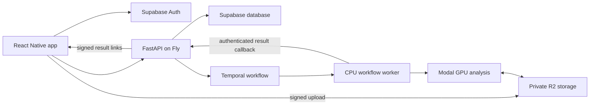

# Spolysis

Spolysis is a tennis motion app focused entirely on 3D analysis.
Choose a stroke and handedness, record or import a video, and review a suggested correction on your own motion.
The app includes analysis history, video playback and sharing, joint-angle comparisons, and a rotatable 3D viewer with playback and scrubbing.

Image keypoints remain an internal input to monocular 3D reconstruction.
All measurements are estimates in relative coordinates, not calibrated biomechanical measurements.

## Current status

The 3D GPU pipeline is deployed on Modal and has processed real THETIS forehand, backhand, serve, and volley videos through reconstruction, comparison, correction, and video rendering.
The app and API implementation are present, with validation evidence and release blockers in [Implementation status](docs/IMPLEMENTATION_STATUS.md).
Android APK and standalone iOS simulator builds are available from that status page.
Production sign-in and the final API rollout are blocked by an unavailable Supabase project.
Do not interpret this repository as an already released, validated consumer product.

## Architecture



The GPU path uses RTMPose-x, pretrained MotionBERT, Savitzky-Golay smoothing, phase-anchored angle alignment against Tennis-MoCap, and bone-preserving joint corrections.
It analyzes the strongest swing with up to 1.5 seconds of context on either side.
Feedback is generated from measured differences using deterministic templates.
The on-device framing check uses Apple Vision on iOS and ML Kit on Android.

Future improvements and their tradeoffs are collected in [v2 options](v2.md).
They are proposals awaiting a product decision, not a committed roadmap.

## Local development

The app uses Expo SDK 57, React Native 0.86, and the New Architecture.
Use Node 22.13 or newer, Python 3.11, Xcode 26.4 or newer, and CocoaPods.
Copy `.env.example` to `.env` and configure the required services.
Copy only the three `EXPO_PUBLIC_*` values into `app/.env`; never put service credentials in the app.

```sh
npm --prefix app ci
npm --prefix app run ios
```

The app requires a native development build because of its camera and pose modules.
Expo Go cannot run those modules.
A real phone is needed for live recording; the simulator supports imported video and result review.

```sh
python -m venv .venv
source .venv/bin/activate
pip install -r api/requirements.txt modal==1.5.3
uvicorn api.main:app --reload --port 8000
```

Set `EXPO_PUBLIC_API_URL` to a URL reachable from the test device.
A physical phone cannot reach your computer through `localhost`.

## Database and deployment

Apply `api/migrations/001_init.sql`, `002_premium_columns.sql`, and `003_3d_analysis.sql` in order through the Supabase SQL editor or an authenticated Postgres connection.
The third migration makes new jobs 3D-only and removes client write access to jobs and results.
Keep R2 public access disabled for uploads and result artifacts.

Configure Fly secrets from `.env.example`, plus the workflow worker's `MODAL_TOKEN_ID` and `MODAL_TOKEN_SECRET`.
The worker uses the same Temporal namespace and task queue as the API.
Configure the Modal secret `spolysis-secrets` with the pipeline's R2 credentials and `INTERNAL_API_SECRET`.

```sh
modal deploy pipeline/app.py
fly deploy --config fly.runtime.toml
```

Run these from the repository root after the database migrations succeed.
`fly.runtime.toml` defines separate API and worker processes.
The workflow worker must stay running to consume jobs.
See [Pipeline setup](pipeline/README.md) for model and data details.

## Checks

```sh
npm --prefix app run build:viewer
npm --prefix app run typecheck
npm --prefix app run lint
python -m pytest -q
python -m ruff check api pipeline tests
```

Python tests require the API dependencies plus `pytest`, NumPy, SciPy, OpenCV, and dtaidistance.
Geometry and pipeline integration tests use synthetic articulated motion and temporary references; they do not require downloaded datasets or model weights.
Those tests validate implementation contracts, not reconstruction accuracy on tennis footage.
Native simulator test source and the isolated UI fixture server are in `app/e2e`.
Never deploy the fixture server or point a distribution build at it.

## Data attribution

Reference sequences derive from [Tennis-MoCap](https://github.com/jdpulgarin/Tennis-MoCap), licensed CC BY-SA 3.0.
The reference players are regional high-performance players, not an ATP/WTA professional benchmark.
The live pipeline tests used expert forehand, backhand, serve, and volley clips from [THETIS](https://github.com/THETIS-dataset/dataset).
SportsPose training access and commercial permission have not been obtained.
