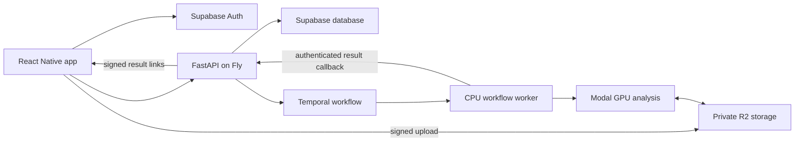

# Spolysis

Spolysis is a sports motion analysis app, with tennis as its first supported sport.
Choose a sport, record or import a video, and review your movement and suggested corrections.
Table tennis, soccer, and basketball are visible as placeholders and do not submit analyses yet.
The app includes analysis history, video playback and sharing, joint-angle comparisons, and a rotatable 3D viewer with playback and scrubbing.

Image keypoints remain an internal input to monocular 3D reconstruction.
All measurements are estimates in relative coordinates, not calibrated biomechanical measurements.

Start with [Get started](#get-started) to set up the project and complete your first analysis.

## Current status

The 3D GPU pipeline is deployed on Modal and has processed real THETIS forehand, backhand, serve, and volley videos through reconstruction, comparison, correction, and video rendering.
The app and API implementation are present, with validation evidence and release blockers in [Implementation status](docs/IMPLEMENTATION_STATUS.md).
Android APK and standalone iOS simulator builds are available from that status page.
Production sign-in, database writes, and the final API rollout remain unverified.
Later connectivity checks superseded the earlier Supabase DNS outage; see the dated evidence in [Athlete review](docs/athlete-review.md).
Do not interpret this repository as an already released, validated consumer product.

## Architecture



The GPU path uses RTMPose-x, pretrained MotionBERT, Savitzky-Golay smoothing, phase-anchored angle alignment against Tennis-MoCap, and bone-preserving joint corrections.
It analyzes the strongest swing with up to 1.5 seconds of context on either side.
Feedback is generated from measured differences using deterministic templates.
The on-device framing check uses Apple Vision on iOS and ML Kit on Android.
The app's sport catalog and sport-specific movement definitions live under `app/src/sports`.
Only the tennis track is connected to the current API and analysis pipeline.
Adding a sport requires its own movement definitions, data and evaluation, and backend analysis contract before enabling its card.

## Adding a sport

Add the sport's definition in its own module under `app/src/sports`, then register it in `app/src/sports/catalog.ts`.
The catalog drives the sport chooser and the active tennis movement choices.
Keep a sport marked unavailable until its upload and result schema, analysis stages, reference data, and validation are ready.
The current API stores tennis movement types without a sport identifier, so a future backend rollout needs a coordinated API and database change before saving other sports' analyses.

Future improvements and their tradeoffs are collected in [v2 options](v2.md).
They are proposals awaiting a product decision, not a committed roadmap.

## Get started

### 1. Prepare your development tools

Run the commands below from the directory containing this README, `app/`, and `api/`.
The app uses Expo SDK 57, React Native 0.86, and the New Architecture.
Install Node 22.13 or newer and Python 3.11.
For iOS, use a Mac with Xcode 26.4 or newer, an installed iOS simulator runtime, and CocoaPods.
For Android, install Android Studio, its SDK tools, and an emulator or connect an Android phone.

The app requires a native development build because of its camera and pose modules.
Expo Go cannot run those modules.
A real phone is needed for live recording; the simulator supports imported video and result review.

### 2. Configure your services

Create local configuration files without overwriting existing settings:

```sh
cp -n .env.example .env
cp -n app/.env.example app/.env
```

Fill in `.env` with your Supabase, private R2, Upstash, Temporal, Modal, and internal API settings.
Use a working Supabase project and apply the migrations listed under [Database and deployment](#database-and-deployment).
Use a working development project for local integration; successful health checks alone do not establish production sign-in or database readiness.

Set these three values in `app/.env`:

| Variable | Value |
| --- | --- |
| `EXPO_PUBLIC_API_URL` | Your running API's URL, reachable from the device. |
| `EXPO_PUBLIC_SUPABASE_URL` | Your Supabase project URL. |
| `EXPO_PUBLIC_SUPABASE_ANON_KEY` | That project's public anon key. |

Keep service-role keys, storage credentials, and internal secrets out of `app/.env`.
For a local API, use `http://localhost:8000` on the iOS simulator, `http://10.0.2.2:8000` on the Android emulator, or your computer's LAN IP on a physical phone connected to the same network.
Restart Metro after changing app environment values.

### 3. Start the API and analysis worker

In one terminal, create the Python environment and start the API:

```sh
python3.11 -m venv .venv
source .venv/bin/activate
pip install -r api/requirements.txt modal==1.5.3
uvicorn api.main:app --reload --host 0.0.0.0 --port 8000
```

Check that `http://localhost:8000/health` responds.
This confirms that the API is running; completing an analysis also requires the database, storage, Temporal worker, and deployed Modal pipeline.

In another terminal, start the CPU workflow worker:

```sh
source .venv/bin/activate
python -m pipeline.temporal.worker
```

Set `INTERNAL_API_URL=http://localhost:8000` when both the API and worker run on your computer.
Use the same `INTERNAL_API_SECRET`, Temporal namespace, and task queue for both processes.
Configure Modal authentication and deploy the GPU pipeline using [Pipeline setup](pipeline/README.md) before submitting an analysis.
If you use an already configured hosted API and worker, skip the local server commands and point the app at that API.

### 4. Launch the app

Install dependencies once:

```sh
npm --prefix app ci
```

Build and launch on your chosen platform:

```sh
# iOS
npm --prefix app run ios

# Android
npm --prefix app run android
```

These commands also build the embedded 3D viewer and start Metro.
For subsequent sessions with the native development build already installed, run `npm --prefix app start` and open that build on your device or simulator.
Keep Metro running while using the development app.

### 5. Complete your first analysis

1. Tap **Find your next move ↗** on the welcome screen to create an account, confirm your email if required, and sign in.
2. On the empty analyses screen, tap **Choose a sport**.
3. Choose Tennis, then choose your stroke type and playing hand.
4. Record or import a video with your full body and racket in view.
5. Wait for the upload and analysis to finish.
6. Review the correction overlay, rotate and scrub the 3D viewer, and compare the suggested changes.

If you need to check the UI without working backend services, follow the isolated fixture instructions in [Native UI checks](app/e2e/README.md).
The fixture is for development only and does not validate production sign-in or reconstruction accuracy.

## Database and deployment

Apply `api/migrations/001_init.sql`, `002_premium_columns.sql`, `003_3d_analysis.sql`, and `004_result_fault_phase.sql` in order through the Supabase SQL editor or an authenticated Postgres connection.
The third migration makes new jobs 3D-only and removes client write access to jobs and results.
The fourth adds the optional primary-phase label written by current result callbacks; existing results remain readable.
Keep R2 public access disabled for uploads and result artifacts.

Configure Fly secrets from `.env.example`, plus the workflow worker's `MODAL_TOKEN_ID` and `MODAL_TOKEN_SECRET`.
The worker uses the same Temporal namespace and task queue as the API.
Configure the Modal secret `spolysis-secrets` with the pipeline's R2 credentials and `INTERNAL_API_SECRET`.

```sh
modal deploy pipeline/app.py
fly deploy --config fly.runtime.toml
```

Run these from the repository root after the database migrations succeed.
`fly.runtime.toml` defines separate API and worker processes.
The workflow worker must stay running to consume jobs.
Before release, the captain must verify the live Fly worker, an active poller on the configured `tennis-analysis` queue, migrations 001-004, disabled R2 public access, and one real signed-in analysis through result retrieval.
An API health response alone does not verify these requirements.
See [Pipeline setup](pipeline/README.md) for model and data details.

## Checks

For isolated unattended runs, see [Overnight work with GNHF](docs/overnight.md).

For local CPU checks, install Python 3.11 and FFmpeg, then create a separate test environment:

```sh
python3.11 -m venv .venv-test
.venv-test/bin/python -m pip install -r requirements-dev.txt
```

```sh
npm --prefix app run build:viewer
npm --prefix app run typecheck
npm --prefix app run lint
.venv-test/bin/python -m pytest -q
.venv-test/bin/python -m ruff check api pipeline tests
```

The CPU test dependencies are listed in `requirements-dev.txt`; GPU deployment dependencies remain in `pipeline/requirements.txt`.
Geometry and pipeline integration tests use synthetic articulated motion and temporary references; they do not require downloaded datasets or model weights.
Those tests validate implementation contracts, not reconstruction accuracy on tennis footage.
Native simulator test source and the isolated UI fixture server are in `app/e2e`.
Never deploy the fixture server or point a distribution build at it.

## Data attribution

Reference sequences derive from [Tennis-MoCap](https://github.com/jdpulgarin/Tennis-MoCap), licensed CC BY-SA 3.0.
The reference players are regional high-performance players, not an ATP/WTA professional benchmark.
The live pipeline tests used expert forehand, backhand, serve, and volley clips from [THETIS](https://github.com/THETIS-dataset/dataset).
SportsPose training access and commercial permission have not been obtained.
